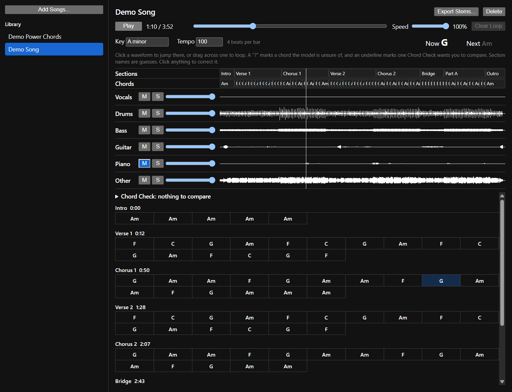
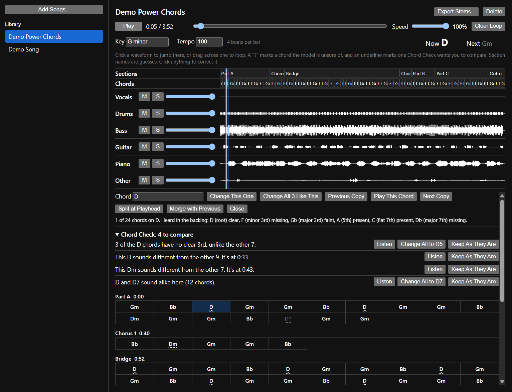
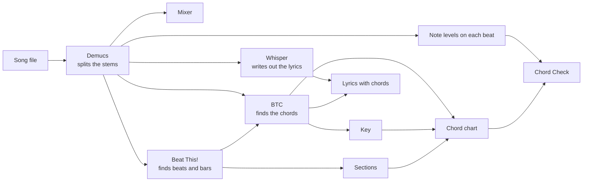

# Music in Parts

A desktop app for learning and arranging song covers. Drop in a song and it splits into separate instrument tracks, then works out the key, tempo, chords and sections, so you can spend your time playing instead of figuring things out by ear.

It runs entirely on your own computer, with no accounts, uploads or subscriptions.



*The screenshots use synthetic demo songs with no real singing, which is why the vocals track is empty.*

## What it does

### Split a song into stems

Any audio or video file becomes six tracks: vocals, drums, bass, guitar, piano and other.

- Mute, solo or change the volume of any track while you play along.
- Loop a section by dragging across a waveform.
- Slow down to 50% without changing the pitch.
- Export the stems as 24-bit WAV files for your music program.

### See how the song is built

- Find the key and tempo.
- Follow the current and next chord as the song plays.
- Read a chord chart of every bar, grouped by section, which stays with the music.
- Click a section to jump to it or loop it.

### Sing along with lyrics and chords

The lyrics are written out from the vocal track, with a time for every word, and each chord appears above the word where it changes.

- The word being sung lights up as the song plays, and clicking any word jumps there.
- Instrumental stretches show their chords on a row of their own.
- The language is detected automatically, or you can pick it. English, Hindi, Japanese, Korean, Spanish and Filipino have been tested, and many more are available.
- Hindi, Japanese and Korean lyrics can also be shown in English letters, so you can sing them without reading the original script.
- Paste the real lyrics from anywhere and the app lines them up with the singing, fixing any misheard words.

### Learn the chords on guitar or piano

The Chord Guides tab shows how to play every chord in the song, with large diagrams for the chord playing now and the one coming next.

- **Guitar:** finger diagrams with open, barre and movable shapes, and several shapes to choose from for each chord. Slash chords like D/F# put the right note in the bass.
- **Capo:** the app suggests a capo when it turns barre chords into easy open shapes, and shows which shape to play for any capo you pick.
- **Piano:** keyboard diagrams with the left hand bass note and right hand chord, plus smooth voicings that keep your right hand close to where it already is.

Your choice of instrument, capo and shapes is remembered for each song.

### Find the solos and write out the notes

Every part is written out as notes, and solos are found automatically.

- **Solos:** stretches where nobody sings and one instrument takes the lead, like a guitar or piano solo, are listed with buttons to show their notes or loop them.
- **Guitar and bass tab:** notes are placed on the neck so the hand moves as little as possible, with one column per sixteenth note and bar lines from the song's beat.
- **Note names:** any part can be listed bar by bar, like `C4 E4 (G4 B4)`.
- **Piano roll:** a picture of the notes that follows the song, where clicking jumps there.
- **Any section:** loop a section to write out just that part of the song.
- **MIDI:** export every part as a MIDI file, ready for virtual instruments in your music program.

### Check the chords

Chord names can be close calls, because D, Dm and D7 can sound nearly the same when the deciding note is faint or missing. Chord Check compares every copy of a chord in the song and points out where the names don't match what it hears.



- **Different names, same sound:** it suggests one name when chords sound alike.
- **Odd ones out:** it flags copies that don't sound like the others with that name.
- **The evidence:** it shows which notes it heard in each chord.
- **Your ear decides:** step through every chord on the same root and hear each one on a loop.

Nothing changes until you say so. Correct one chord or every matching copy at once, and your changes are saved with the song and can be reverted.

## How it works



Electron provides the app window and interface, and Python does the audio work on your graphics card.

## What to expect

| Part | How reliable it is |
|---|---|
| **Vocals, drums and bass** | Usually separate well |
| **Guitar and piano** | Decent, though piano is the less reliable of the two |
| **Other** | Strings, synths and anything else end up mixed together |
| **Chords** | Best on pop and rock, weaker on jazz and on music not built around chord changes |
| **Tempo** | Can come out at half or double the feel you'd count |
| **Key** | Can pick the wrong one of a major and minor pair that share notes |
| **Section names** | Educated guesses from repetition and loudness |
| **Chord Check** | New and only lightly tested, so treat it as a prompt to listen |
| **Solos and lead lines** | Clean single-note solos come out well. Fast runs, bends, distortion and solos that share the stem with other instruments cause wrong or missing notes |
| **Full parts** | A rough draft: chords and busy parts pick up extra notes from other instruments |
| **Lyrics** | Good on clear singing. Heavy effects, fast rap, mumbled words and songs that switch languages cause more mistakes |
| **Romanised lyrics** | Readable, but Japanese kanji can get the wrong reading, and Hindi spellings follow fixed rules rather than common usage |

Unsure chords are marked with a "?". If a whole song's chords look unreliable, the app says so and lists its main notes instead.

## Getting started

You need Windows, [Node.js](https://nodejs.org) and [Python 3.11](https://www.python.org/downloads/). An NVIDIA graphics card is strongly recommended, because the CPU is much slower.

```bash
git clone https://github.com/shmizi/music-in-parts.git
```

```bash
cd music-in-parts
```

```bash
npm install
```

```bash
npm run setup
```

Setup downloads several GB of audio libraries into `%LOCALAPPDATA%\MusicInParts`, which keeps them out of the project folder. It's finished when it prints `Engine is ready.` Run it again whenever `engine/requirements.txt` changes. The first song you add also downloads the lyrics model, about 1.5 GB.

Start the app:

```bash
npm start
```

Or add a desktop shortcut:

```bash
npm run shortcut
```

## Roadmap

- [x] Stem separation, mixer, looping and slowdown
- [x] Key, tempo, chords and sections, with an editable chord chart
- [x] Chord Check
- [x] Lyrics with chords above the words, in many languages
- [x] Guitar and piano chord diagrams, with capo suggestions
- [ ] Pasting chord sheets to line up with the song
- [x] Finding solos and writing out their notes, with guitar and bass tab
- [x] MIDI for every part, to use with virtual instruments
- [ ] A written breakdown of drum patterns
- [ ] A written breakdown of each part, with piano voicings and guitar shapes, capo suggestions and tabs
- [ ] Transposing to your vocal range, vocal harmony suggestions and reharmonisation ideas

## Project layout

| Path | What's there |
|---|---|
| `app/` | The Electron app: the window, file access and processing queue |
| `app/renderer/` | The interface, mixer, chord chart and Chord Check |
| `engine/` | The Python audio engine for separation and analysis |
| `engine/btc/` | The BTC chord model code, under its own MIT licence |
| `test/` | Tests for the interface logic |

Songs and downloaded models are stored in `%LOCALAPPDATA%\MusicInParts`.

```bash
npm test
```

```bash
npm run test:engine
```

## Credits

- [Demucs](https://github.com/facebookresearch/demucs) for stem separation
- [Beat This!](https://github.com/CPJKU/beat_this) for beats and bars
- [BTC](https://github.com/jayg996/BTC-ISMIR19) for chord recognition
- [librosa](https://librosa.org) for audio analysis
- [Whisper](https://github.com/openai/whisper) for lyrics
- [Basic Pitch](https://github.com/spotify/basic-pitch) for writing out notes
- [cutlet](https://github.com/polm/cutlet) for Japanese romaji, and [indic-transliteration](https://github.com/indic-transliteration/indic_transliteration_py) for Hindi

## A note on copyright

This is a tool for learning songs. Lyrics stay on your computer, and the stems it creates are still the original recordings, so replay the parts yourself if you upload a cover, and expect that covers can still be claimed by the rights holder.
