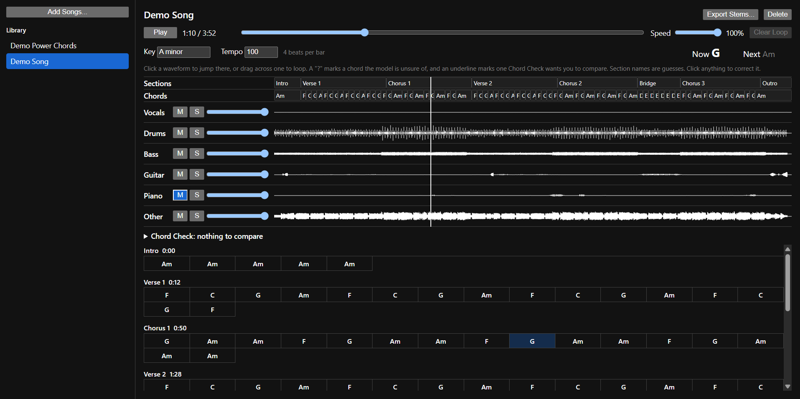
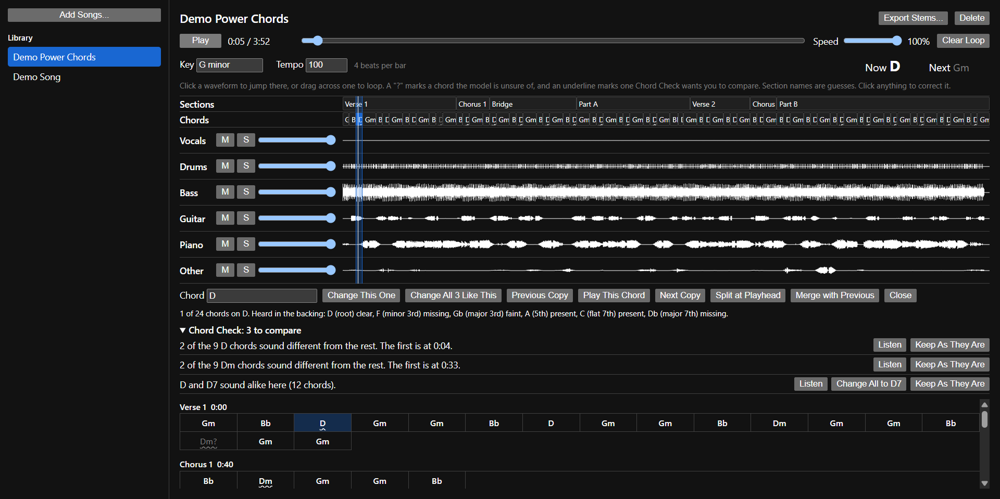
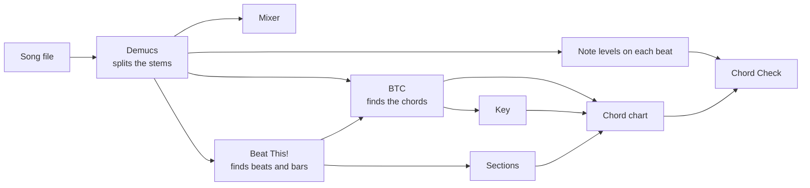

# Music in Parts

A desktop app for learning and arranging song covers. Drop in a song and it splits into separate instrument tracks, then works out the key, tempo, chords and sections, so you can spend your time playing instead of figuring things out by ear.

It runs entirely on your own computer, with no accounts, uploads or subscriptions.



*The screenshots use synthetic demo songs with no real singing, which is why the vocals track is empty.*

## What it does

### Split a song into stems

Any audio or video file becomes six tracks: vocals, drums, bass, guitar, piano and other.

- Mute, solo or change the volume of any track while you play along.
- Loop a section by dragging across a waveform.
- Slow down to 50% without changing the pitch.
- Export the stems as 24-bit WAV files for your music program.

### See how the song is built

- Find the key and tempo.
- Follow the current and next chord as the song plays.
- Read a chord chart of every bar, grouped by section, which stays with the music.
- Click a section to jump to it or loop it.

### Check the chords

Chord names can be close calls, because D, Dm and D7 can sound nearly the same when the deciding note is faint or missing. Chord Check compares every copy of a chord in the song and points out where the names don't match what it hears.



- **Different names, same sound:** it suggests one name when chords sound alike.
- **Odd ones out:** it flags copies that don't sound like the others with that name.
- **The evidence:** it shows which notes it heard in each chord.
- **Your ear decides:** step through every chord on the same root and hear each one on a loop.

Nothing changes until you say so. Correct one chord or every matching copy at once, and your changes are saved with the song and can be reverted.

## How it works



Electron provides the app window and interface, and Python does the audio work on your graphics card.

## What to expect

| Part | How reliable it is |
|---|---|
| **Vocals, drums and bass** | Usually separate well |
| **Guitar and piano** | Decent, though piano is the less reliable of the two |
| **Other** | Strings, synths and anything else end up mixed together |
| **Chords** | Best on pop and rock, weaker on jazz and on music not built around chord changes |
| **Tempo** | Can come out at half or double the feel you'd count |
| **Key** | Can pick the wrong one of a major and minor pair that share notes |
| **Section names** | Educated guesses from repetition and loudness |
| **Chord Check** | New and only lightly tested, so treat it as a prompt to listen |

Unsure chords are marked with a "?". If a whole song's chords look unreliable, the app says so and lists its main notes instead.

## Getting started

You need Windows, [Node.js](https://nodejs.org) and [Python 3.11](https://www.python.org/downloads/). An NVIDIA graphics card is strongly recommended, because the CPU is much slower.

```bash
git clone https://github.com/shmizi/music-in-parts.git
```

```bash
cd music-in-parts
```

```bash
npm install
```

```bash
npm run setup
```

Setup downloads several GB of audio libraries into `%LOCALAPPDATA%\MusicInParts`, which keeps them out of the project folder. It's finished when it prints `Engine is ready.` Run it again whenever `engine/requirements.txt` changes.

Start the app:

```bash
npm start
```

Or add a desktop shortcut:

```bash
npm run shortcut
```

## Roadmap

- [x] Stem separation, mixer, looping and slowdown
- [x] Key, tempo, chords and sections, with an editable chord chart
- [x] Chord Check
- [ ] MIDI for every part, to use with virtual instruments
- [ ] A written breakdown of each part, with piano voicings and guitar shapes, capo suggestions and tabs
- [ ] Transposing to your vocal range, vocal harmony suggestions and reharmonisation ideas

## Project layout

| Path | What's there |
|---|---|
| `app/` | The Electron app: the window, file access and processing queue |
| `app/renderer/` | The interface, mixer, chord chart and Chord Check |
| `engine/` | The Python audio engine for separation and analysis |
| `engine/btc/` | The BTC chord model code, under its own MIT licence |
| `test/` | Tests for the interface logic |

Songs and downloaded models are stored in `%LOCALAPPDATA%\MusicInParts`.

```bash
npm test
```

```bash
npm run test:engine
```

## Credits

- [Demucs](https://github.com/facebookresearch/demucs) for stem separation
- [Beat This!](https://github.com/CPJKU/beat_this) for beats and bars
- [BTC](https://github.com/jayg996/BTC-ISMIR19) for chord recognition
- [librosa](https://librosa.org) for audio analysis

## A note on copyright

This is a tool for learning songs. The stems it creates are still the original recordings, so replay the parts yourself if you upload a cover, and expect that covers can still be claimed by the rights holder.
